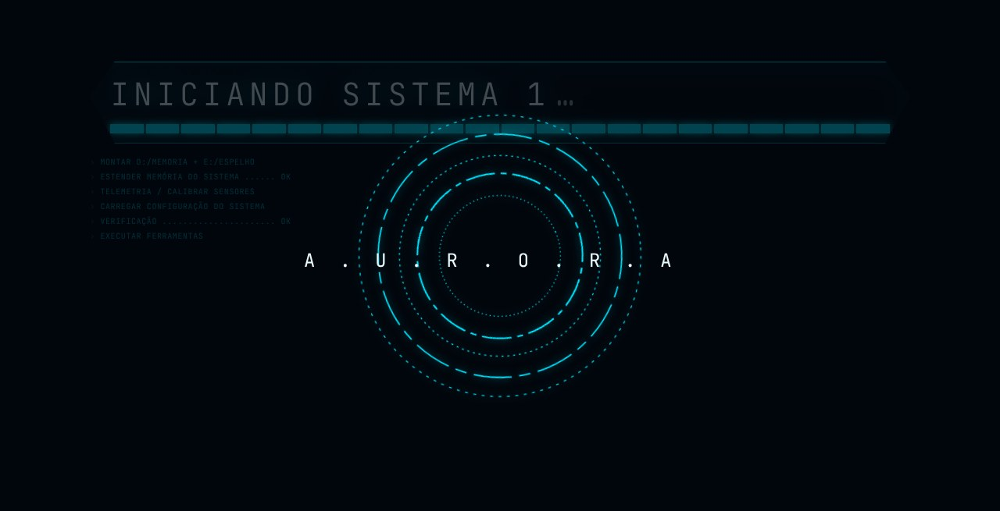

<p align="center">
  
</p>

<h1 align="center">A.U.R.O.R.A.</h1>

<p align="center">
  <b>Assistente Universal de Raciocínio, Observação e Resposta Automática</b><br>
  Uma assistente de voz em português, com interface holográfica, que liga junto com o Windows e usa o Claude Code como cérebro.
</p>

<p align="center">
  <a href="LEIA-ME.md">Guia completo</a> ·
  <a href="#in-english">English</a> ·
  <a href="LICENSE">Licença MIT</a>
</p>

---

Você liga o computador, a janela da AURORA abre sozinha, o reator acende e ela diz **"Bom dia, senhor. Todos os sistemas prontos."** A partir daí é só falar: **"Ei Aurora, …"**.

Ela responde em voz alta, pesquisa na web, lê páginas e artigos, mostra o que achou em painéis na tela, olha pela câmera, usa o seu próprio Chrome já logado, lembra do que você pediu semanas atrás e abre programas por dentro para explicar o que eles fazem.

## Por que ela é diferente

- **Português de verdade.** Atende por "Ei Aurora", entende português do Brasil, responde em português e escolhe sozinha a melhor voz brasileira instalada. Não é uma tradução por cima de um assistente em inglês: as regras de fala, as palavras de "pare" e "espera", e o jeito de falar números e horas foram feitos para o português.
- **Liga junto com o computador.** Um comando cria o atalho na inicialização do Windows. A cada login ela sobe escondida, abre a própria janela e liga sozinha. Fechar a janela desliga tudo; se algo cair, ela religa.
- **Memória que você controla.** Tudo o que ela anota fica num arquivo de texto que você abre e edita, com as conversas de cada dia ao lado. A pasta é espelhada em outro disco (D: e E:, por padrão) e, se um dos dois falhar, ela recupera sozinha ao ligar. Ela se recusa a guardar senhas e chaves.
- **Engenharia reversa por voz.** "Ei Aurora, o que esse programa faz?" Com o [REA](https://github.com/morluto/rea) ela inspeciona executáveis, bibliotecas, APKs e sites e responde em uma ou duas frases, com os detalhes na tela. Só as 125 ferramentas de leitura ficam liberadas.
- **Olha tudo, não muda nada.** Por padrão ela pode pesquisar, ler e analisar, mas não apaga arquivos, não roda comandos e não clica em nada. Ações só com `--writes`, e você decide quando.
- **Sem chave de API.** O cérebro é o Claude Code rodando no seu computador, com o seu login e todos os servidores MCP que você já configurou.

<p align="center">
  
</p>

## Começar

Precisa de **Windows 10 ou 11**, **Node.js 22**, **Google Chrome** (ou Edge) e do **Claude Code** com login feito.

```powershell
npm install -g @anthropic-ai/claude-code
claude            # faça o login e saia com /exit

git clone https://github.com/cedu360/Aurora C:\Aurora
cd C:\Aurora
npm install
npm run setup               # confere o computador, não muda nada
npm run inicio-automatico   # liga junto com o Windows e cria o atalho na área de trabalho
```

Dê dois cliques no atalho **Aurora** da área de trabalho. Na primeira vez a janela pede o microfone: clique em **Permitir** e diga **"Ei Aurora, que horas são?"**

Prefere ligar à mão? `npm start` e abra http://localhost:5173 no Chrome. O passo a passo, a configuração e a solução de problemas estão no [LEIA-ME](LEIA-ME.md).

## O que pedir

| Você diz | Ela faz |
|---|---|
| "Ei Aurora, qual a principal notícia de hoje?" | pesquisa, resume em uma frase e abre o artigo num painel |
| "Lembre que o fornecedor de cabos é a Elétrica Silva." | anota na memória, que sobrevive a desligar o computador |
| "O que você lembra sobre o fornecedor?" | procura nas anotações e nas conversas antigas |
| "O que esse programa faz?" (com o caminho) | inspeciona o arquivo com o REA e explica |
| "Abra a câmera e me diga o que você vê." | olha pela webcam e descreve |
| "Abra o meu e-mail no Chrome." | usa o seu Chrome logado, pela extensão Claude |
| "Deixe a tela vermelha." | ela muda a própria interface |

Teclas: **Espaço** fala sem dizer o nome, **V** troca a voz, **G** liga o controle com as mãos pela câmera, **D** abre o diagnóstico, **Esc** põe em espera.

## Como funciona

```
 navegador (a cara)                      ponte Node (o cérebro)
 React + Three.js + voz do navegador ⇄  bridge/server.mjs ⇄ Claude Agent SDK ⇄ Claude
 http://localhost:5173        WebSocket  ws://localhost:8787      │
                                                                  ├─ memória   (D:\ + espelho em E:\)
                                                                  ├─ REA       (engenharia reversa)
                                                                  ├─ Chrome    (o seu, pela extensão)
                                                                  └─ os seus servidores MCP
```

A página desenha a interface, ouve e fala. A ponte roda o Claude Code como biblioteca, decide quais ferramentas podem ser usadas (tudo que escreve fica bloqueado até `--writes`) e manda de volta o texto, que a página fala frase por frase enquanto o resto ainda está chegando.

## Créditos

A AURORA começou como um fork do [JARVIS do Aditya Dewaskar](https://github.com/adewaskar/jarvis), que fez a interface holográfica, a ponte com o Claude Code e o laço de voz. Esta versão acrescenta o português, o Windows, o início automático, a memória em disco, o REA e a nova identidade. Licença MIT, a mesma do original ([LICENSE](LICENSE)).

Música de Kevin MacLeod (incompetech.com), licença Creative Commons Attribution 4.0 ([créditos](public/audio/CREDITS.md)). Engenharia reversa pelo [REA](https://github.com/morluto/rea). Use a análise de programas só em software seu ou que você tenha autorização para analisar.

---

## In English

**AURORA** is a Portuguese-first voice assistant with a holographic interface, built on Claude Code. Say "Hey Aurora" and she answers out loud, searches, reads, shows what she found on screen, sees through the camera, drives your own signed-in Chrome, remembers across sessions and reverse engineers programs with [REA](https://github.com/morluto/rea).

What sets her apart: she starts with Windows and switches herself on; her memory is plain text you can edit, mirrored to a second disk and repaired on start; she is read-only until you pass `--writes`; and she needs no API key, only your Claude Code login. Set `AURORA_LANG=en-GB` and `VITE_LANG=en-GB` in `.env.local` for British English with a British voice.

Quick start on Windows: install Node.js 22, Chrome and Claude Code (log in once), then `git clone https://github.com/cedu360/Aurora`, `npm install`, `npm run inicio-automatico`, and double-click the **Aurora** shortcut. Forked from [adewaskar/jarvis](https://github.com/adewaskar/jarvis), MIT licence.
